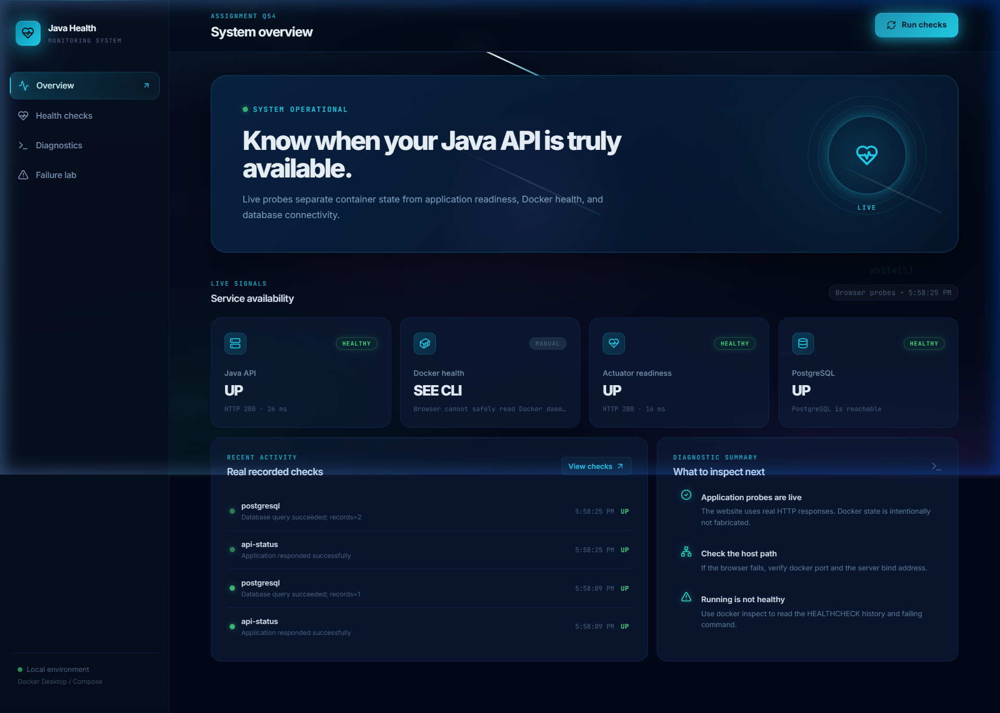
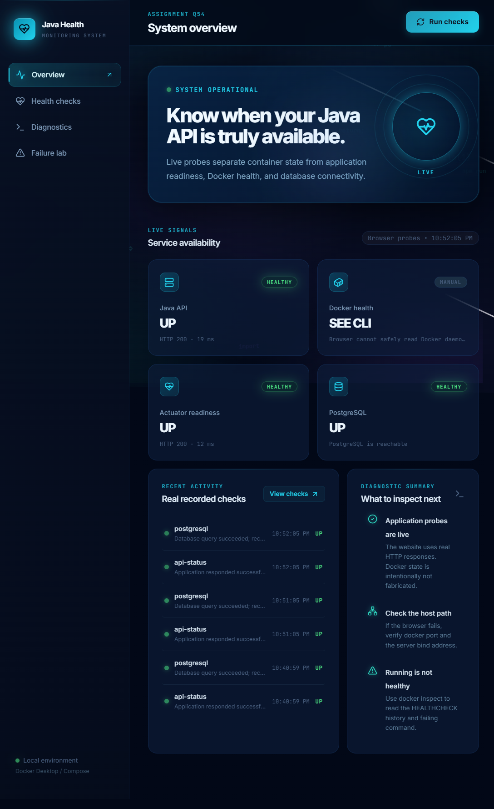
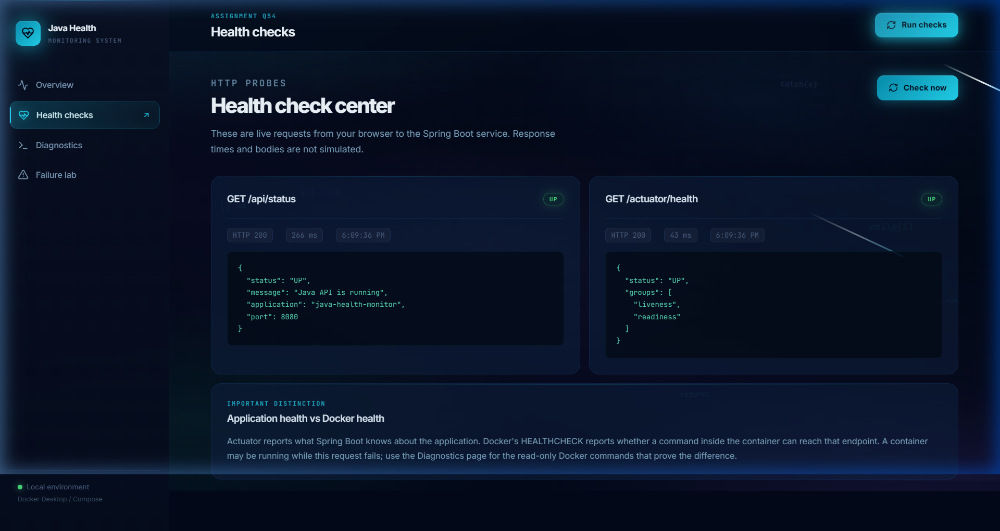
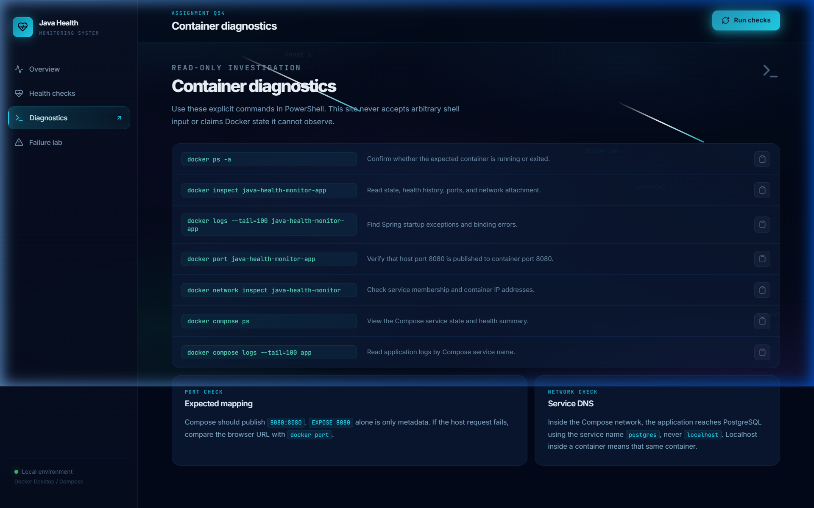
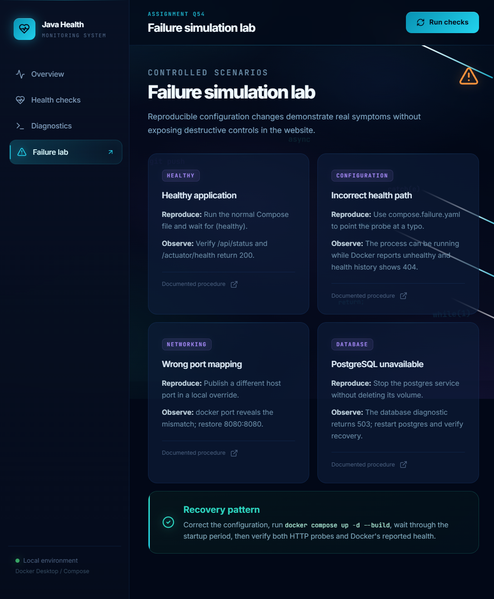

<h4 align="center">
  A full-stack observability dashboard that proves the difference between a <em>running</em> container and a <em>healthy</em> application.
</h4>

<p align="center">
  
  
  
  
  
  
</p>

<p align="center">
  <a href="#-features">Features</a> •
  <a href="#-screenshots">Screenshots</a> •
  <a href="#-architecture">Architecture</a> •
  <a href="#-file-structure">File Structure</a> •
  <a href="#-api-reference">API Reference</a> •
  <a href="#-quick-start">Quick Start</a> •
  <a href="#-failure-scenarios">Failure Scenarios</a>
</p>

---

## ✨ Features

| Feature | Description |
|---|---|
| 🔴 **Live HTTP Probes** | Real browser-to-backend fetch calls — no simulated data |
| 🐘 **Database Diagnostics** | PostgreSQL reachability tested via JPA query on every probe |
| 📜 **Persisted History** | Every check is recorded in PostgreSQL and shown in the dashboard |
| 🐳 **Docker Health Awareness** | Explains the difference between `docker ps` state and `/actuator/health` |
| 🔬 **Failure Lab** | Four reproducible failure scenarios with step-by-step reproduction guides |
| 🔧 **Container Diagnostics** | One-click copy for the exact Docker CLI commands needed to debug |
| 🎨 **Glassmorphism UI** | Premium dark UI with animated shooting stars, gradient orbs, and floating code glyphs |

---

## 🏗️ Architecture

### High-Level System Diagram

```
+-------------------------------------------------------------------------------+
|                         Docker Network: java-health-monitor                   |
|                                                                               |
|    +----------------------+       nginx proxy       +----------------------+  |
|    |      Browser         | ----------------------->|   Frontend (nginx)   |  |
|    |    localhost:3000    |                         |   Port 80 (internal) |  |
|    +----------+-----------+                         |   React + TypeScript |  |
|               |                                     +----------+-----------+  |
|               | fetch /api/*                                   | proxy_pass   |
|               | fetch /actuator/*                              v              |
|               |                                      +----------------------+ |
|               +----------------------------------->  |   Spring Boot App    | |
|                                                      |   Port 8080          | |
|                                                      |   /api/status        | |
|                                                      |   /api/health-history| |
|                                                      |   /api/diagnostics/* | |
|                                                      |   /actuator/health   | |
|                                                      +----------+-----------+ |
|                                                                 | JDBC        |
|                                                                 v             |
|                                                      +----------------------+ |
|                                                      |   PostgreSQL 16      | |
|                                                      |   Port 5432          | |
|                                                      |   health_history     | |
|                                                      |   table              | |
|                                                      +----------------------+ |
+-------------------------------------------------------------------------------+
```

### Request Flow Diagram

```
User clicks "Run checks"
         │
         ▼
  React App (browser)
         │
    ┌────┴──────────────────────────────────┐
    │   Promise.all([...]) — 3 parallel     │
    │   fetch calls with 5s timeout         │
    └────┬──────────────┬────────────────┬──┘
         │              │                │
         ▼              ▼                ▼
  GET /api/status  GET /actuator   GET /api/diagnostics
                   /health         /database
         │              │                │
         ▼              ▼                ▼
  MonitorController  Actuator      MonitorController
  returns JSON       auto-config   queries PostgreSQL
  saves to DB        checks DB     saves result
         │              │                │
         └──────────────┴────────────────┘
                         │
                         ▼
               React updates state
               UI shows UP / DOWN
                         │
                         ▼
            GET /api/health-history
            Fetches last 20 records
            Renders history panel
```

### Docker Health vs Application Health

```
docker ps ──▶ "Up 2 minutes (healthy)"
                       │
                       │  means Docker HEALTHCHECK ran:
                       │  curl http://127.0.0.1:8080/actuator/health
                       │
                       ▼
              ┌─────────────────────┐
              │  NOT the same as:   │
              └─────────────────────┘
                       │
                       ▼
         Browser probe to /actuator/health
         ──▶ Spring Boot asks:
             - Is datasource UP?
             - Is diskSpace OK?
             - Are all components UP?
```

---

## 📁 File Structure

```
Java-Health-Check/
│
├── 📄 compose.yaml                     # Main Docker Compose — all 3 services
├── 📄 compose.failure.yaml             # Failure scenario override (wrong health path)
├── 📄 .env                             # ⚠️ Local secrets (git-ignored)
├── 📄 .env.example                     # Template for .env
├── 📄 .gitignore
│
├── 🗂️ backend/                         # Spring Boot Java application
│   ├── 📄 Dockerfile                   # Multi-stage Maven build → JRE runtime
│   ├── 📄 pom.xml                      # Maven deps: Spring Web, JPA, Actuator, PostgreSQL
│   └── src/
│       └── main/
│           ├── java/com/example/monitor/
│           │   ├── 📄 HealthMonitorApplication.java    # @SpringBootApplication entry
│           │   ├── 📄 MonitorController.java           # REST endpoints /api/*
│           │   ├── 📄 HealthHistory.java               # @Entity — DB table schema
│           │   └── 📄 HealthHistoryRepository.java     # JPA repository interface
│           └── resources/
│               └── 📄 application.properties           # Server config, datasource, actuator
│
├── 🗂️ frontend/                        # React + TypeScript SPA
│   ├── 📄 Dockerfile                   # Vite build → nginx serve
│   ├── 📄 nginx.conf                   # Reverse proxy /api/* → backend:8080
│   ├── 📄 index.html                   # App shell
│   ├── 📄 vite.config.ts               # Vite config with API proxy
│   ├── 📄 tailwind.config.js           # Tailwind (base/components/utilities only)
│   └── src/
│       ├── 📄 main.tsx                 # React DOM entry
│       ├── 📄 App.tsx                  # All pages + components + probe logic
│       └── 📄 styles.css              # Full design system (glassmorphism, animations)
│
├── 🗂️ database/
│   └── init/                           # SQL run on first postgres startup
│
└── 🗂️ docs/
    └── screenshots/                    # README images
```

---

## 🔌 API Reference

All endpoints are served by the Spring Boot application on port **8080** internally (proxied through nginx on port **3000** in production).

### `GET /api/status`
Returns the application's live status and records a check to the database.

**Response `200 OK`:**
```json
{
  "status": "UP",
  "message": "Java API is running",
  "application": "java-health-monitor",
  "port": 8080
}
```

---

### `GET /actuator/health`
Spring Boot Actuator endpoint — reports DB connectivity and overall application health.

**Response `200 OK` (healthy):**
```json
{
  "status": "UP"
}
```

**Response `503 Service Unavailable` (DB down):**
```json
{
  "status": "DOWN"
}
```

---

### `GET /api/diagnostics/database`
Runs a live `SELECT COUNT(*)` against the `health_history` table and returns the result.

**Response `200 OK`:**
```json
{
  "status": "UP",
  "message": "PostgreSQL is reachable",
  "recordCount": 42,
  "responseTimeMs": 12
}
```

**Response `503`:**
```json
{
  "status": "DOWN",
  "message": "PostgreSQL is unavailable",
  "responseTimeMs": 5001
}
```

---

### `GET /api/health-history`
Returns the 20 most recent health check records from the database (descending by time).

**Response `200 OK`:**
```json
[
  {
    "id": 17,
    "checkName": "api-status",
    "status": "UP",
    "httpStatus": 200,
    "responseTimeMs": 8,
    "detail": "Application responded successfully",
    "checkedAt": "2026-10-27T12:34:00Z"
  }
]
```

---

## 🚀 Quick Start

### Prerequisites

| Tool | Version | Purpose |
|---|---|---|
| Docker Desktop | 4.x+ | Container runtime |
| Docker Compose | v2+ | Multi-service orchestration |
| Git | any | Clone the repo |

> Node.js is **not required** to run the app — everything builds inside Docker.

---

### 1. Clone the repository

```bash
git clone https://github.com/aadidevj007/Java-Health-Check.git
cd Java-Health-Check
```

### 2. Configure environment

```bash
cp .env.example .env
```

Edit `.env` with your preferred credentials:

```env
POSTGRES_DB=healthmonitor
POSTGRES_USER=healthmonitor
POSTGRES_PASSWORD=your-secure-password
```

> ⚠️ **Never commit `.env`** — it is already in `.gitignore`.

### 3. Build and start

```bash
docker compose up -d --build
```

This will:
1. 🔨 Compile the Java app with Maven inside Docker
2. 🐘 Start PostgreSQL and wait until `pg_isready` succeeds
3. 🌱 Start Spring Boot and wait until `/actuator/health` returns `200`
4. 🌐 Start nginx and serve the React SPA

### 4. Open the dashboard

| URL | Description |
|---|---|
| **http://localhost:3000** | Production UI (nginx + React) |
| **http://localhost:8080/api/status** | Spring Boot API direct |
| **http://localhost:8080/actuator/health** | Actuator health direct |

### 5. Verify all containers are healthy

```bash
docker ps --filter "name=java-health-monitor" \
  --format "table {{.Names}}\t{{.Status}}\t{{.Ports}}"
```

Expected output:
```
NAMES                          STATUS                    PORTS
java-health-monitor-frontend   Up 30 seconds (healthy)   0.0.0.0:3000->80/tcp
java-health-monitor-app        Up 40 seconds (healthy)   0.0.0.0:8080->8080/tcp
java-health-monitor-postgres   Up 50 seconds (healthy)   5432/tcp
```

---

## 🧪 Failure Scenarios

Each scenario can be reproduced safely without modifying application code.

### Scenario 1 — Incorrect Health Path (Configuration Error)

```bash
# Start with wrong HEALTHCHECK path
docker compose -f compose.failure.yaml up -d --build

# Docker will report (unhealthy) even though the process is running
docker ps  # STATUS: Up X seconds (unhealthy)

# But the API still responds:
curl http://localhost:8080/api/status  # 200 OK

# Restore:
docker compose down && docker compose up -d
```

**Lesson:** A `running` container ≠ a `healthy` application.

---

### Scenario 2 — Wrong Port Mapping (Networking Error)

```bash
# Edit compose.yaml: change "8080:8080" to "9999:8080"
# Then restart:
docker compose up -d

# Browser probe fails (port 9999 not what frontend expects)
# docker port reveals the mismatch:
docker port java-health-monitor-app

# Restore to 8080:8080 and restart
```

---

### Scenario 3 — PostgreSQL Unavailable (Database Error)

```bash
# Stop postgres without removing its volume
docker compose stop postgres

# The API stays running but /api/diagnostics/database returns 503
curl http://localhost:8080/api/diagnostics/database
# {"status":"DOWN","message":"PostgreSQL is unavailable"}

# Actuator also degrades:
curl http://localhost:8080/actuator/health
# {"status":"DOWN"}

# Restore:
docker compose start postgres
```

---

### Scenario 4 — Full Stack Recovery

After any failure, run:

```bash
docker compose down -v          # Remove containers + volumes
docker compose up -d --build    # Rebuild and restart clean
```

Wait ~40 seconds for Spring Boot to initialize, then click **Run checks** in the dashboard.

---

## 🐳 Docker Commands Cheat Sheet

```bash
# View all container states
docker ps -a

# Read app health history and config
docker inspect java-health-monitor-app

# Follow Spring Boot startup logs
docker logs --tail=100 -f java-health-monitor-app

# Check published ports
docker port java-health-monitor-app

# Inspect the Docker network
docker network inspect java-health-monitor

# Compose service overview
docker compose ps

# Compose logs by service
docker compose logs --tail=100 app
docker compose logs --tail=100 postgres
```

---

## 🛠️ Development Setup (Frontend Hot Reload)

```bash
# Start only backend services with Docker
docker compose up -d postgres app

# Run frontend with Vite dev server (hot reload)
cd frontend
npm install
npm run dev
# Open http://localhost:5173
```

Vite proxies `/api/*` and `/actuator/*` to `http://localhost:8080` via `vite.config.ts`.

---

## 🗃️ Database Schema

```sql
CREATE TABLE health_history (
    id               BIGSERIAL    PRIMARY KEY,
    check_name       VARCHAR(255),
    status           VARCHAR(10),   -- 'UP' | 'DOWN'
    http_status      INTEGER,       -- 200 | 503
    response_time_ms BIGINT,
    detail           VARCHAR(255),
    checked_at       TIMESTAMPTZ    DEFAULT NOW()
);
```

Managed automatically by Spring JPA (`ddl-auto=update`).

---

## 🔐 Environment Variables

| Variable | Default | Description |
|---|---|---|
| `POSTGRES_DB` | `healthmonitor` | Database name |
| `POSTGRES_USER` | `healthmonitor` | DB username |
| `POSTGRES_PASSWORD` | *(required)* | DB password — set in `.env` |
| `SPRING_DATASOURCE_URL` | auto-set by compose | JDBC connection string |
| `SPRING_DATASOURCE_USERNAME` | auto-set by compose | Spring datasource user |
| `SPRING_DATASOURCE_PASSWORD` | auto-set by compose | Spring datasource password |

---

## 🎨 UI Design System

The frontend uses a custom CSS design system (no component library) built with:

- **Colors:** Deep navy base (`#020817`) with cyan (`#22d3ee`), violet (`#a78bfa`), teal (`#2dd4bf`) accents
- **Typography:** Inter (UI) + JetBrains Mono (code/monospace)
- **Effects:** Glassmorphism panels, CSS `backdrop-filter`, neon box-shadows
- **Animations:**
  - 🌌 5-layer animated radial gradient orbs (slow drift)
  - 🌠 10 CSS shooting stars (diagonal streaks with glow tails)
  - 💻 12 floating code glyphs (`{}`, `</>`, `() =>`, etc.)
  - 🌊 Aurora sweep background animation
  - ✨ Card hover lift + border glow
  - 🔵 Sonar pulse rings on the hero heartbeat icon
  - 📑 Page enter fade+scale animation on every nav change

---

## 📋 Tech Stack

| Layer | Technology |
|---|---|
| **Language (backend)** | Java 17 |
| **Framework** | Spring Boot 3.x |
| **ORM** | Spring Data JPA / Hibernate |
| **Database** | PostgreSQL 16 (Alpine) |
| **Observability** | Spring Boot Actuator |
| **Language (frontend)** | TypeScript 5.x |
| **UI Framework** | React 18 |
| **Build Tool** | Vite 6 |
| **Styling** | Vanilla CSS (custom design system) + Tailwind base |
| **Icons** | Lucide React |
| **Web Server** | nginx (production), Vite dev server (development) |
| **Containerisation** | Docker + Docker Compose v2 |
| **CI** | GitHub Actions (`.github/`) |

---

## 📸 Screenshots

<h1 align="center">
  <br>
  
  <br>
  ☕ Java Health Monitor
  <br>
</h1>

### 🖥️ System Overview — Dashboard

> Live probe results, service availability cards, and recent check history.


### ⚡ Dashboard — After Running Checks

> All services reporting `UP` with real HTTP response times.



### 💓 Health Check Center

> Live HTTP probes to `/api/status` and `/actuator/health` with raw JSON responses.



### 🔍 Container Diagnostics

> Copy-ready Docker CLI commands for investigating container state and networking.



### 🧪 Failure Simulation Lab

> Reproducible failure scenarios: wrong health path, port mismatch, DB unavailable.



---
